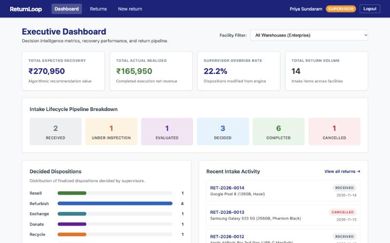
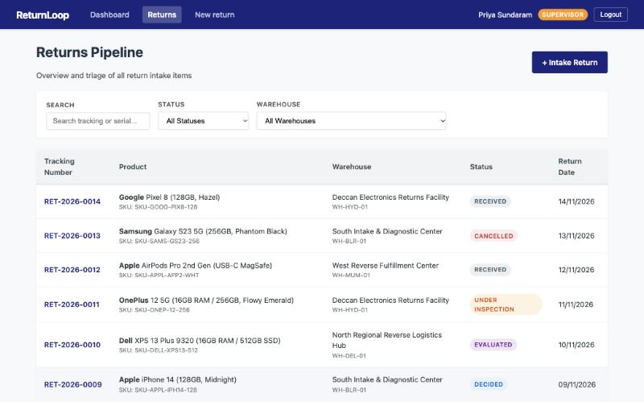
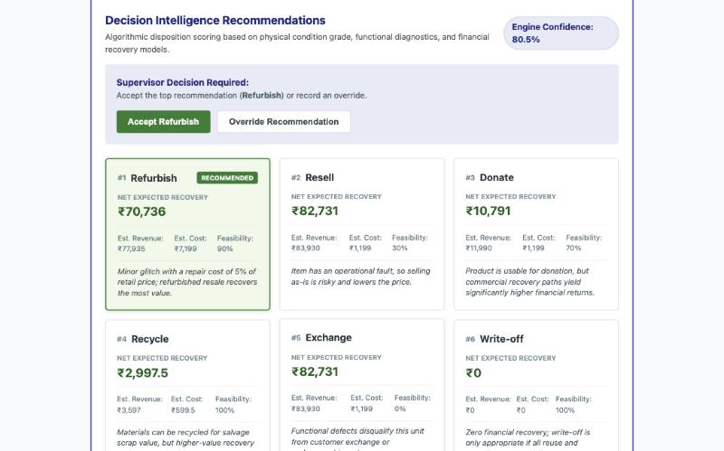
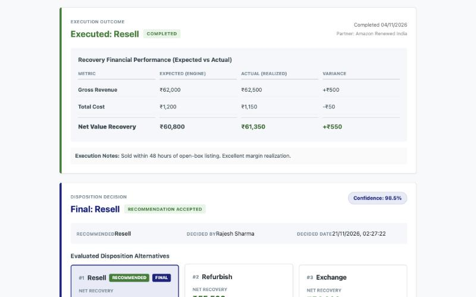

# Return Loop

Return Loop is a decision intelligence application for returned electronics. It helps retailers work out the best next destination for each returned product.

Every return ends in one of six dispositions:

1. **Resell**: sell the item again as-is.
2. **Refurbish**: repair or restore the item, then resell it.
3. **Exchange**: use the item to fulfil a customer replacement.
4. **Donate**: give the item to a charitable organization.
5. **Recycle**: send the item for responsible material recovery.
6. **Write-off**: remove the item from inventory as a loss.

Warehouse staff log each return and inspect it. A rule-based recommendation engine then scores all six options and suggests the best one. A supervisor accepts or overrides it, and finally records what really happened and how much money was recovered.



## How a return moves through the app

```text
RECEIVED ─► UNDER_INSPECTION ─► EVALUATED ─► DECIDED ─► COMPLETED
   └────────────── cancel (before DECIDED) ──────────────► CANCELLED
```

| Stage | Who | What happens |
| --- | --- | --- |
| Log a return | Inspector | Product, warehouse, reason and customer comment |
| Inspect | Inspector | Condition grade, functional status, packaging, accessories, repair estimate |
| Recommend | System | The engine ranks all six dispositions with expected revenue, cost, feasibility and a reason |
| Decide | Supervisor | Accept the top pick, or override it with a written reason |
| Outcome | Supervisor | Actual revenue, cost and partner; compared with what the engine expected |

| Returns list | Recommendation |
| --- | --- |
|  |  |



## Roles

Login uses JWT. Each operator has one role, and each role can do everything the role above it in this table can.

| Role | Can do |
| --- | --- |
| `INSPECTOR` | Log, view and inspect returns **from their own warehouse only**; see recommendations |
| `SUPERVISOR` | All warehouses; make decisions, record outcomes, cancel returns, see the dashboard |
| `ADMIN` | Everything, plus manage products, warehouses and operator accounts |

An inspector can't see another warehouse's returns at all. Opening one gives "not found", exactly like a return that doesn't exist.

## Technology stack

| Layer | Technology |
| --- | --- |
| Database | PostgreSQL |
| Backend | Node.js 22+, Express 5 (CommonJS), `pg` |
| Auth | JSON Web Tokens (`jsonwebtoken`), passwords hashed with `bcryptjs` |
| Frontend | React with Vite, React Router, Axios |
| Tests | Node.js built-in test runner (`node:test`) |

## Getting started

### 1. Prerequisites

- Node.js 22 or later, and npm
- PostgreSQL 12 or later, running locally

### 2. Install

```bash
git clone https://github.com/divyanshj25604-arch/ReturnLoop_AP_2026.git
cd ReturnLoop_AP_2026
npm install
npm --prefix client install
```

### 3. Configure `.env`

```bash
cp .env.example .env
```

Then edit `.env`:

| Variable | Required | Description |
| --- | --- | --- |
| `DATABASE_URL` | yes | PostgreSQL connection string, e.g. `postgresql://localhost:5432/returnloop_db` |
| `JWT_SECRET` | yes | Long random string used to sign login tokens. The server won't start without it |
| `JWT_EXPIRES_IN` | no | How long a login lasts. Default `8h` |
| `PORT` | no | API port. Default `3000` |
| `NODE_ENV` | no | Default `development` |

Generate a `JWT_SECRET` with:

```bash
node -e "console.log(require('crypto').randomBytes(48).toString('hex'))"
```

Never commit `.env`; it's ignored by git.

### 4. Create and fill the database

```bash
createdb returnloop_db
```

```bash
npm run db:setup
```

`db:setup` runs `dbms/03_schema.sql` and then `dbms/04_seed.sql`. It drops and rebuilds every table, so you can run it any time to reset to the sample data.

### 5. Run the app

Start the API and the frontend in two terminals:

```bash
npm run dev
```

```bash
npm run client:dev
```

Open http://localhost:5173. The frontend forwards `/api` requests to the API on port 3000.

## Test accounts

The seed data creates these accounts. **All of them use the password `Devanshi1234`.** It's for local development only; never use it anywhere real.

| Email | Role | Warehouse |
| --- | --- | --- |
| `rajesh.sharma@returnloop.internal` | ADMIN | WH-DEL-01 |
| `priya.sundaram@returnloop.internal` | SUPERVISOR | WH-BLR-01 |
| `amit.kulkarni@returnloop.internal` | INSPECTOR | WH-MUM-01 |
| `sneha.reddy@returnloop.internal` | INSPECTOR | WH-HYD-01 |
| `vikram.verma@returnloop.internal` | INSPECTOR | WH-DEL-01 |

Try logging in as Amit and then as Sneha to see the warehouse privacy rule in action.

## API

The full contract, with every request and response, is in **[docs/api.md](docs/api.md)**. All endpoints are under `/api`, and everything except `/health` and `/auth/login` needs an `Authorization: Bearer <token>` header.

| Area | Endpoints | Minimum role |
| --- | --- | --- |
| Health | `GET /health` | public |
| Auth | `POST /auth/login`, `GET /auth/me`, `PATCH /auth/password` | public / any |
| Returns | `GET /returns`, `GET /returns/:id`, `POST /returns` | INSPECTOR |
| Inspection | `POST /returns/:id/start-inspection`, `POST /returns/:id/inspections` | INSPECTOR |
| Recommendation | `GET /returns/:id/recommendation` | INSPECTOR |
| Decision and outcome | `POST /returns/:id/decision`, `POST /returns/:id/outcome`, `POST /returns/:id/cancel` | SUPERVISOR |
| Dashboard | `GET /dashboard` | SUPERVISOR |
| Catalog | `GET /products`, `GET /warehouses` | INSPECTOR |
| Admin | `POST`/`PATCH` `/products`, `/warehouses`, `/operators`; `GET /operators` | ADMIN |

Errors always look like `{ "success": false, "message": "...", "errors": [{ "field", "message" }] }`. `errors` appears only when input is invalid.

## Recommendation engine

`src/services/recommendation.service.js` is a pure function: it takes the product price and the latest inspection, and returns all six dispositions ranked. For each option it estimates revenue and cost and gives a feasibility score from 0 to 1. Options are ranked by `net recovery × feasibility`. The confidence score reflects how far ahead the top option is, and every option comes with a plain-English reason.

The full rules are in **[docs/engine.md](docs/engine.md)**.

## Running the tests

The API tests run against your local database, so set it up first:

```bash
npm run db:setup
```

```bash
npm test
```

`.env` must contain `DATABASE_URL` and `JWT_SECRET`. Test files run one at a time and delete everything they create, so the seed data is unchanged afterwards. If a run is interrupted, run `npm run db:setup` again.

`tests/full-flow.test.js` walks one return through the whole lifecycle and checks the role and warehouse rules for every endpoint. `tests/recommendation.service.test.js` covers the engine.

To check that the frontend builds:

```bash
npm run client:build
```

## Folder structure

```text
ReturnLoop_AP_2026/
├── src/                 Express API
│   ├── config/          env.js, db.js
│   ├── routes/          URL definitions, mounted under /api
│   ├── controllers/     request handling, validation, status codes
│   ├── models/          SQL queries
│   ├── services/        recommendation engine, warehouse access rules
│   ├── middleware/      auth, roles, error handling
│   └── utils/           validation, transactions, tokens, constants
├── client/              React app (Vite)
├── dbms/                schema, seed data, queries, design and ER docs
├── scripts/             db-setup.js
├── tests/               API and engine tests
└── docs/                api.md, engine.md, TEAM_PLAN.md, screenshots/
```

## Team

| Name | Area |
| --- | --- |
| Divyansh Jha | Backend API, JWT auth, API tests, end-to-end fixes |
| Shreyansh Rathaur | Database schema and seed data, recommendation engine |
| Devanshi Kumari | React frontend, dashboard SQL, ER diagram and query analysis |

How the work was split and ordered is in [docs/TEAM_PLAN.md](docs/TEAM_PLAN.md).

## License

No license has been selected yet.
