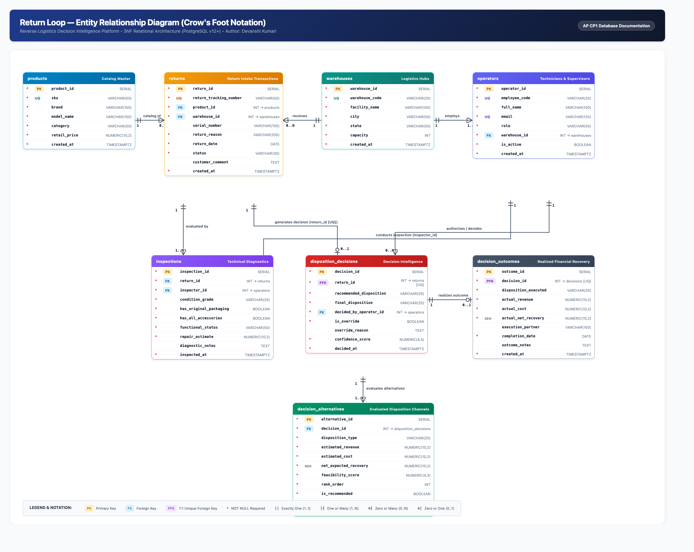
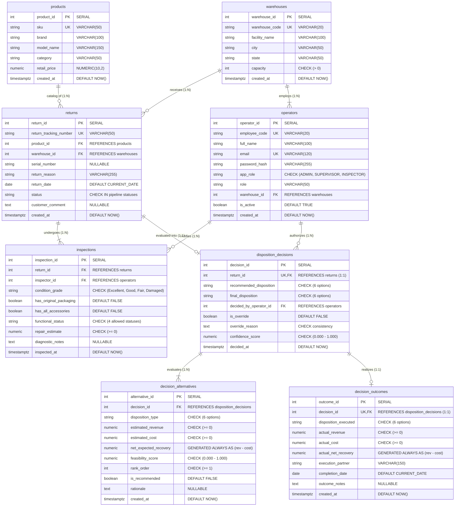

# Return Loop — Entity-Relationship (ER) Diagram & Relational Architecture

**Project:** Return Loop (Decision Intelligence Platform for Returned Electronics)  
**Role:** Database Queries & Testing / ER Documentation (Devanshi Kumari)  
**Assignment:** AP CP1  
**Collaboration Note:** Built directly upon the approved Database Design (`dbms/00_database_design.md`) and normalized SQL Schema (`dbms/03_schema.sql`).

---

## 1. Executive Summary & Purpose

The **Return Loop** platform manages the reverse-logistics lifecycle for returned consumer electronics across regional intake fulfillment centers. Upon arrival, returned products undergo multi-point technical inspections to assess physical grade, operational status, and repair viability. An algorithmic decision intelligence engine evaluates multiple disposition options:
1. **Resell** (direct open-box liquidation)
2. **Refurbish** (repair, sanitize, and recertify)
3. **Exchange** (replenish customer warranty replacement pool)
4. **Donate** (educational or charitable distribution)
5. **Recycle** (e-waste scrap and raw material recovery)
6. **Write-off** (operational salvage loss)

This document formalizes the Entity-Relationship (ER) diagram representing the physical and logical database structure implemented in PostgreSQL (v12+). It models eight core entities in strict Third Normal Form (3NF), ensuring ACID compliance, declarative referential integrity, and zero data redundancy.

---

## 2. Visual Entity-Relationship Diagram

A high-resolution, publication-quality Crow's Foot ER diagram has been rendered and committed as an image asset:

*Figure 1: Complete Crow's Foot Entity-Relationship Diagram for Return Loop reverse logistics platform.*

---

## 3. Crow's Foot Notation & Cardinality Grammar

The diagram and underlying relational model adhere strictly to standard **Crow's Foot Notation**:

| Notation Glyph | Cardinality Description | Relational Meaning |
|---|---|---|
| `||` | **Mandatory One (1..1)** | Exactly one parent instance must exist for the child entity. |
| `o|` | **Optional One (0..1)** | Zero or at most one instance can exist (enforced by `UNIQUE` on a nullable or foreign key). |
| `|{` | **Mandatory Many (1..N)** | At least one, but potentially many child instances must exist. |
| `o{` | **Optional Many (0..N)** | Zero, one, or many child instances may exist (standard 1:N foreign key relationship). |

---

## 4. Mermaid Relational Model (Crow's Foot)

Below is the complete text-executable Mermaid ER specification illustrating all entities, attributes, primary keys, foreign keys, and cardinalities:

---

## 5. Entity Data Dictionary & Schema Specification

The schema matches the production DDL in `dbms/03_schema.sql` exactly:

### 5.1 `products` (Master Catalog)
* **Purpose:** Serves as the authoritative master catalog for electronic items processed in the reverse supply chain.
* **Primary Key:** `product_id` (`SERIAL`, auto-incrementing integer).
* **Alternate Key:** `sku` (`VARCHAR(50)`, unique stock keeping unit).
* **Attributes:** `brand`, `model_name`, `category`, `retail_price` (NUMERIC >= 0), `created_at`.
* **Integrity:** `ON DELETE RESTRICT` protects catalog entries from deletion if active returns reference them.

### 5.2 `warehouses` (Logistics Intake Facilities)
* **Purpose:** Physical facilities where customer returns are delivered, staged, triaged, and dispatched.
* **Primary Key:** `warehouse_id` (`SERIAL`).
* **Alternate Key:** `warehouse_code` (`VARCHAR(20)`, unique identifier e.g. `WH-DEL-01`).
* **Attributes:** `facility_name`, `city`, `state`, `capacity` (INT > 0), `created_at`.
* **Integrity:** `ON DELETE RESTRICT` protects facility records from deletion if referenced by operators or returns.

### 5.3 `operators` (Diagnostic Specialists & Triage Supervisors)
* **Purpose:** Authorized personnel performing inspections, condition grading, and disposition determinations.
* **Primary Key:** `operator_id` (`SERIAL`).
* **Alternate Keys:** `employee_code` (`VARCHAR(20)`), `email` (`VARCHAR(120)`).
* **Foreign Key:** `warehouse_id` references `warehouses(warehouse_id)` on delete `RESTRICT`.
* **Attributes:** `full_name`, `password_hash`, `app_role` (`ADMIN`, `SUPERVISOR`, `INSPECTOR`), `role`, `is_active`, `created_at`.

### 5.4 `returns` (Return Intake Transactions)
* **Purpose:** Core transaction unit tracking a customer return package through its reverse logistics lifecycle.
* **Primary Key:** `return_id` (`SERIAL`).
* **Alternate Key:** `return_tracking_number` (`VARCHAR(50)`, unique identifier e.g. `RET-2026-0001`).
* **Foreign Keys:**
  - `product_id` references `products(product_id)` on delete `RESTRICT`.
  - `warehouse_id` references `warehouses(warehouse_id)` on delete `RESTRICT`.
* **Attributes:** `serial_number`, `return_reason`, `return_date`, `status` (`RECEIVED`, `UNDER_INSPECTION`, `EVALUATED`, `DECIDED`, `COMPLETED`, `CANCELLED`), `customer_comment`, `created_at`.

### 5.5 `inspections` (Multi-Point Diagnostic Records)
* **Purpose:** Multi-point diagnostic assessment capturing condition grade, completeness, and estimated repair cost.
* **Primary Key:** `inspection_id` (`SERIAL`).
* **Foreign Keys:**
  - `return_id` references `returns(return_id)` on delete `CASCADE`.
  - `inspector_id` references `operators(operator_id)` on delete `RESTRICT`.
* **Attributes:** `condition_grade` (`Excellent`, `Good`, `Fair`, `Damaged`), `has_original_packaging`, `has_all_accessories`, `functional_status` (`Fully Functional`, `Minor Glitch`, `Defective Hardware`, `Non-functional`), `repair_estimate` (>= 0), `diagnostic_notes`, `inspected_at`.

### 5.6 `disposition_decisions` (Decision Intelligence Decisions)
* **Purpose:** The algorithmically recommended and supervisor-authorized disposition path for a returned unit.
* **Primary Key:** `decision_id` (`SERIAL`).
* **Foreign Keys & Constraints:**
  - `return_id` references `returns(return_id)` on delete `CASCADE`, enforced as **strictly 1:1** via `UNIQUE(return_id)`.
  - `decided_by_operator_id` references `operators(operator_id)` on delete `RESTRICT`.
* **Attributes:** `recommended_disposition`, `final_disposition`, `is_override`, `override_reason` (enforced by CHECK constraint when `is_override = TRUE`), `confidence_score` (between 0.000 and 1.000), `decided_at`.

### 5.7 `decision_alternatives` (Evaluated Candidate Pathways)
* **Purpose:** Candidate disposition alternatives scored and ranked by the decision engine for a given decision.
* **Primary Key:** `alternative_id` (`SERIAL`).
* **Foreign Key:** `decision_id` references `disposition_decisions(decision_id)` on delete `CASCADE`.
* **Composite Candidate Keys:** `UNIQUE(decision_id, disposition_type)`, `UNIQUE(decision_id, rank_order)`.
* **Attributes:** `disposition_type`, `estimated_revenue`, `estimated_cost`, `net_expected_recovery` (`GENERATED ALWAYS AS (estimated_revenue - estimated_cost) STORED`), `feasibility_score` (0.000 to 1.000), `rank_order` (>= 1), `is_recommended`, `rationale`, `created_at`.

### 5.8 `decision_outcomes` (Financial & Operational Recovery Execution)
* **Purpose:** Post-execution actual financial recovery realized upon liquidation, refurbishing, recycling, or salvage.
* **Primary Key:** `outcome_id` (`SERIAL`).
* **Foreign Key & Constraints:** `decision_id` references `disposition_decisions(decision_id)` on delete `RESTRICT`, enforced as **strictly 1:1** via `UNIQUE(decision_id)`.
* **Attributes:** `disposition_executed`, `actual_revenue`, `actual_cost`, `actual_net_recovery` (`GENERATED ALWAYS AS (actual_revenue - actual_cost) STORED`), `execution_partner`, `completion_date`, `outcome_notes`, `created_at`.

---

## 6. Relational Cardinality & Integrity Analysis

### 6.1 One-to-Many Relationships (1 : N)
1. **`products` (1) to `returns` (0..N):**  
   One catalog SKU can be returned zero or multiple times. A return references exactly one master product (`product_id`).
2. **`warehouses` (1) to `returns` (0..N):**  
   A reverse fulfillment warehouse receives many return packages over time. Each return is routed to exactly one intake warehouse (`warehouse_id`).
3. **`warehouses` (1) to `operators` (1..N):**  
   A logistics center employs a team of technicians and supervisors. Every operator is assigned to a home warehouse (`warehouse_id`).
4. **`returns` (1) to `inspections` (1..N):**  
   A return may undergo initial intake inspection and subsequent specialized diagnostics. Every inspection belongs to one return (`return_id`).
5. **`operators` (1) to `inspections` (0..N):**  
   An operator certifies many inspections. Each inspection record logs the certifying inspector (`inspector_id`).
6. **`operators` (1) to `disposition_decisions` (0..N):**  
   A triage supervisor authorizes or overrides multiple decisions. Every decision records the authorizer (`decided_by_operator_id`).
7. **`disposition_decisions` (1) to `decision_alternatives` (1..N):**  
   Every decision evaluates multiple candidate channels (typically 2 to 6 ranked options). Each alternative belongs to one decision (`decision_id`).

### 6.2 One-to-One Relationships (1 : 1)
1. **`returns` (1) to `disposition_decisions` (0..1):**  
   A return reaches a single final disposition decision. This 1:1 relationship is enforced by `UNIQUE(return_id)` on `disposition_decisions`.
2. **`disposition_decisions` (1) to `decision_outcomes` (0..1):**  
   A finalized decision leads to at most one executed real-world recovery outcome. This 1:1 relationship is enforced by `UNIQUE(decision_id)` on `decision_outcomes`.

### 6.3 Many-to-Many (M : N) Associations
* **`returns` and `operators`:**  
   Formally an M:N associative pattern resolved through `inspections` (multiple operators may perform diagnostic tests on a given return, and one operator inspects many returns) and `disposition_decisions` (operators review decisions on multiple returns).

---

## 7. Coordination & Schema Alignment Certification

This ER documentation and accompanying visual diagram have been verified against:
- **Database Architecture Document:** `dbms/00_database_design.md`
- **Physical Schema DDL:** `dbms/03_schema.sql`
- **Initial Seed Dataset:** `dbms/04_seed.sql`

All table names, column identifiers, foreign-key linkages, and check constraints match the approved schema with 100% fidelity.
